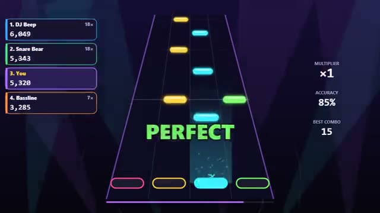

# Rhythm Battle

Same beat, same notes. Out-hit your friends. A multiplayer starter game from [Multiplayer Agent](https://multiplayeragent.com): 2D, versus, 2–4 players, with bots that fill empty seats.

## How it plays

A fresh beat is made for every round, and everyone gets the same notes on 4 lanes. Hit each note as it reaches the line: perfect timing scores most, and a long combo multiplies it. Highest score wins.

**Controls:** D F J K (or the arrow keys); on phones, tap the lanes.

## Make it yours in the Game Builder

Open the [Game Builder](https://multiplayeragent.com), choose **Start from a starter game** and pick Rhythm Battle. It opens as version 1 in your studio, ready to play and publish. Then ask for changes, for example:

- Add hold notes you have to keep pressed
- Make the songs faster every round
- Give each player an avatar that dances when they hit

## Run it yourself

1. Get a free publishable key (`pk_…`) at [multiplayeragent.com](https://multiplayeragent.com).
2. In `index.html`, put it in place of `pk_REPLACE_ME` in the `MP_CONNECT` block.
3. Open `index.html` in a browser. No build step and no server needed.

Without a key it still runs, offline against bots.

## How it is built

- One `index.html`. The comment at the top of the script maps the code and explains the multiplayer. The music is made in the browser with WebAudio from a seed: the melody is the note chart, so everyone hears and plays the same song.
- **Host-run rounds:** One player's browser counts in each song, ends it and posts the results; if it leaves, the next player takes over.
- **Leaderboard:** Each player's best score.
- **Bots:** Bot players hit (and miss) along with you until enough people join.
- **Live sync:** Everyone's score and combo climb on every screen as they play.
- `?attract` runs it offline: bots plus an autopilot for you, from the busy finale of a song. The preview video is recorded from it.

## License

MIT.
